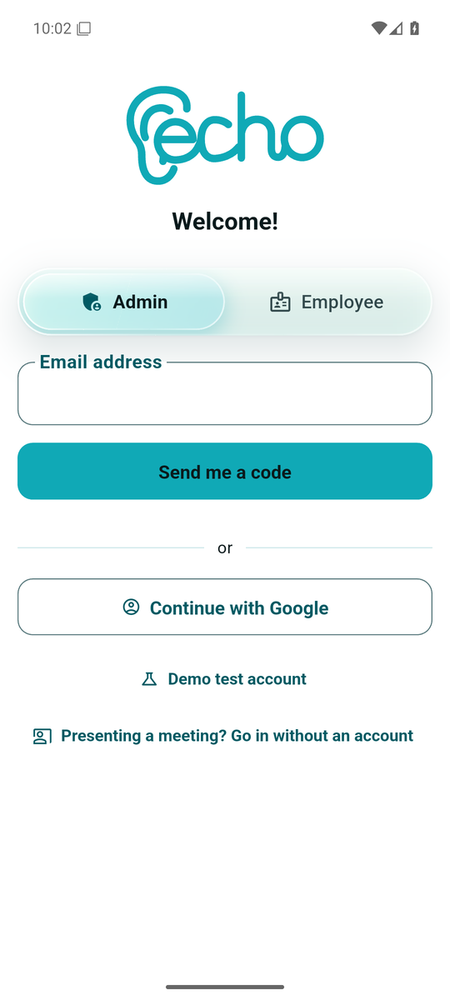
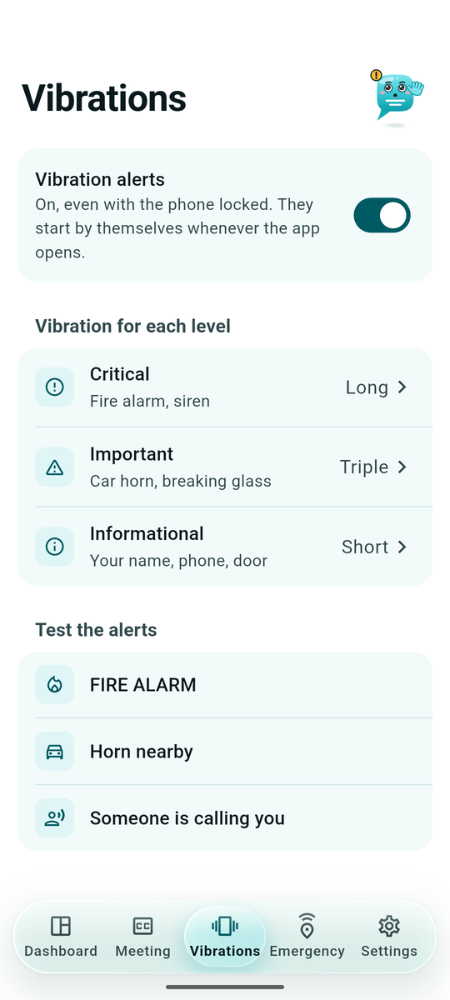
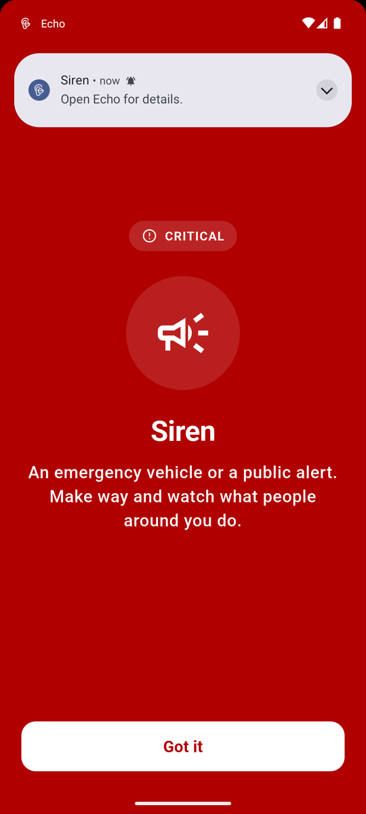
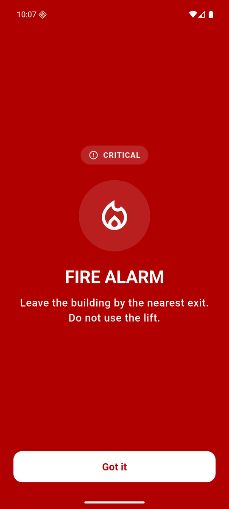
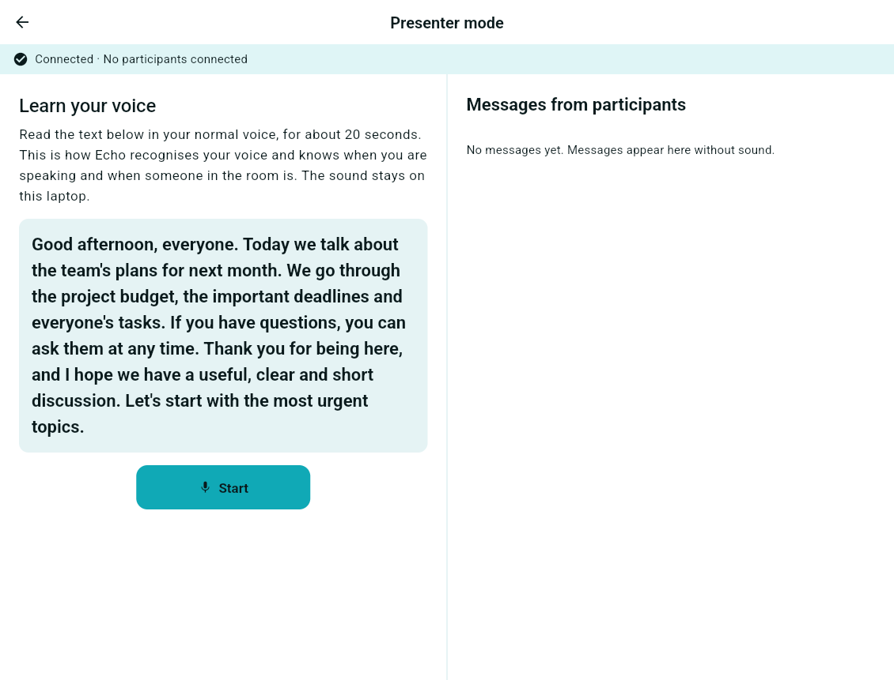
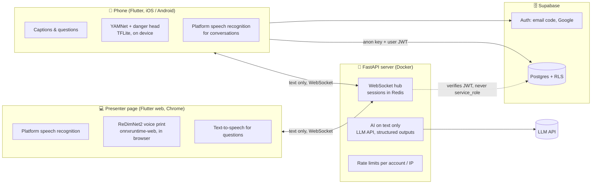

<p align="center">
  
</p>

<h3 align="center">Every Conversation Heard Onscreen</h3>

<p align="center">
  Live, on-device accessibility for deaf and hard-of-hearing people:<br>
  captioned <strong>in-person meetings</strong> that know who is speaking and let you ask without interrupting,<br>
  <strong>visual alerts</strong> for the sounds that keep you safe, and a <strong>clarity coach</strong> for hearing colleagues.
</p>

<p align="center">
  
  
  
  
  
  
  
</p>

<p align="center">
  <a href="#what-echo-does">Features</a> ·
  <a href="#screenshots">Screenshots</a> ·
  <a href="#architecture">Architecture</a> ·
  <a href="#machine-learning">Machine learning</a> ·
  <a href="#engineering">Engineering</a> ·
  <a href="#getting-started">Getting started</a> ·
  <a href="#documentation">Docs</a>
</p>

---

## Why

Live captioning already exists, but it is built around one phone held 30–60 cm from a speaker, or around video calls. The **physical meeting**, with a presenter at the front and an audience in the room, is barely covered: the deaf participant does not know who is talking, cannot tell a question from an answer, and has no quiet way to raise a hand.

Echo turns the laptop that is already next to the speaker into a listener for the whole room, and the participant's own phone into a subtitled, two-way view of the meeting. Everything that hears or sees runs **on the device**: only text ever crosses the network.

## What Echo does

| | Component | What it does |
|---|---|---|
**Meeting assistant** (core) | The speaker's laptop listens to the room, recognises the speaker's voice with a model we fine-tuned, and labels every line **Speaker** / **From the room**; questions from the audience are flagged. The participant reads along on the phone, taps **“I want to ask”**, types the question, the laptop reads it aloud, and **“You've been answered”** lights up automatically when the speaker replies. Summary and action items at the end. No meeting link: the phone pairs once through a QR code. |
**Visible sound** | YAMNet plus our own danger-sound head run on the phone: fire alarm, siren, horn, breaking glass, a phone ringing, a doorbell or a knock. Three alert levels with distinct vibration patterns; a **critical alert covers any screen**, repeats until acknowledged and reaches the lock screen and a smartwatch. Workplace sounds can be taught in three samples (only a fingerprint is kept) and shared across a company. |
**Colleague alarm** | A signed-in colleague raises an emergency from the home screen; everyone within 500 m who reads what is said gets it, and the admin sees who answered “I'm safe” or “I need help”. |
**Ask the meeting** | An agent we wrote ourselves, with `search_transcript` and `read_lines` tools over the transcript, answers questions about the meeting and **cites the exact lines** (`[#12]`). If it is not in the transcript, it says so. |
**Clarity coach** (online meetings) | The *hearing* colleague opens Echo in Chrome next to Teams/Meet. Their own microphone is analysed locally and six discreet alerts appear in an always-on-top window: speaking too fast for captions (threshold calibrated on Romanian), talking over someone, weak microphone, no pauses between ideas, five minutes without a break, background noise. Nothing is stored, by design. |
**Companies** | An admin creates the company and an 8-character join code (hashed, 7-day expiry, rate-limited); employees join with it and record **needs, not diagnoses**. Announcements, shared sounds, and an append-only activity history that every person can read about themselves and admins about their company. |

The product brief, the competitive landscape and the full set of design documents are in [`docs/`](#documentation).

## Screenshots

<p align="center">
  
  &nbsp;&nbsp;
  
  &nbsp;&nbsp;
  
  &nbsp;&nbsp;
  
</p>

<p align="center">
  
  <br><sub>The presenter page, running on the hosted server: the speaker reads 20 seconds of text so Echo can tell their voice from the room; the audio never leaves the laptop.</sub>
</p>

<p align="center">
  
  <br><sub>The mascot is drawn and animated in code (a <code>CustomPainter</code>, ~400 lines), so it blinks, waves and shrinks into the corner when you open the announcements; it respects reduced motion and disappears in high contrast.</sub>
</p>

## Architecture



Rules that never bend:

- **Audio and video never reach our server.** Speech recognition, speaker identification, sound classification and face detection all run on the phone or in the browser; the server only ever sees text.
- **Row Level Security on every table.** The phone talks to Postgres with the public `anon` key and the user's token; the server verifies tokens and holds no privileged key. Admins read their company only through functions that log the access.
- **Append-only activity log**, 12-month retention, the IP address never leaves the database; GDPR reasoning (legal basis, minimisation, retention, deletion) is part of every design document.
- **Accessibility in every screen:** VoiceOver labels, text scaling without clipping, text contrast ≥ 7:1 enforced by a test, 48 px touch targets, and nothing conveyed by colour or sound alone.
- **Romanian and English from day one**, every string in ARB files; a new language is one more file.

## Machine learning

Three small, measured models; no language models trained.

| Model | What we did | Result |
|---|---|---|
| **Speaker verification** (`ml/voice/`) | Fine-tuned [ReDimNet2](https://github.com/IDRnD/ReDimNet) on Romanian speech (VoxPopuli RO) with simulated room acoustics, calibrated the threshold on recorded test meetings, exported to ONNX for the browser. A model ships only if it beats the base one on held-out speakers. | EER **2.10 %** on Romanian speaker pairs (base model: 2.25 %); the speaker is labelled correctly 95 % of the time and the room 100 % |
| **Dangerous sounds** (`tools/train_danger_sounds.py`) | A softmax head over L2-normalised YAMNet embeddings for fire alarm, siren, horn and breaking glass. ESC-50 has no fire alarms, so we synthesise them from the standard patterns (ISO 8201 temporal-three, bells, horns, slow whoop) with reverb, microphone colouring and real background noise. Thresholds are tuned to stay quiet rather than cry wolf. | 4 false alarms in 475 background clips (0.8 %); 8/8 sirens and 7/8 horns in the ESC-50 test fold; the same head runs on the phone (TFLite) and in the browser (TensorFlow.js) |
| **Speech rate** (`ml/voice/echo_voice/speech_rate.py`) | Syllable nuclei from the audio itself (de Jong & Wempe), so the coach works even when the browser tab is in the background. Calibrated on 2 715 VoxPopuli RO clips with transcripts; the Dart and Python analysers are kept identical by a parity test. | 170 words per minute ≈ **4.75 detected syllables / s**, the coach's threshold |

The sound detector can be tried without the app: `python tools/sound_demo.py --file alarm.wav` prints the same alerts the phone would raise.

## Engineering

- **~25 000 lines of code, ~11 700 lines of tests.** 466 Flutter tests (widgets, protocol, transcript numbering, theme contrast, every screen with fakes) and 279 server tests, of which the schema, RLS policies, grants and race conditions run against a **real Postgres**.
- **Load-tested hub:** 200 simultaneous participants, 24 000 of 24 000 messages delivered, median latency 4 ms; session lookups O(1) with a one-minute expiry sweep.
- **AI done carefully:** structured outputs (Pydantic) for summaries and “was that an answer?”, refusal and truncation handled explicitly, transcript text framed as data rather than instructions, citations validated against the transcript, per-account and per-IP hourly limits, a fake client in tests so no suite ever calls the API.
- **Database as a product:** 10 migrations, column-level grants (Supabase grants everything by default, so each table starts with `revoke all`), `SECURITY DEFINER` functions with a fixed `search_path`, a write-only `echo_audit` role for the server, lock ordering and `SKIP LOCKED` for the hot paths, bounded purges.
- **Mobile details:** Android full-screen intents and alarm-category notifications for critical alerts, iOS haptics kept alive while the microphone records, host-audio-tested on an Android 16 emulator; a companion script regenerates launcher, adaptive, notification and iOS icons from the SVG logo.
- **Workflow:** every feature starts as a design document in `docs/specs/` (18 of them), is built test-first, and lands with its migration, its tests and its GDPR section.

## Repository map

```
app/            Flutter: iPhone / Android app and the presenter page (Flutter web)
  lib/core/       protocol, WebSocket client, API, speech recognition, transcript, accounts, history
  lib/features/   home, participant, presenter, alerts, conversation, settings, organization, coach, …
  lib/theme/      one palette (EchoPalette → Material theme), colour-blind palettes, dyslexia mode
  lib/l10n/       Romanian and English (ARB)
  web/voice/      ReDimNet2 ONNX + onnxruntime-web for the browser
server/         FastAPI: session hub, WebSockets, auth, limits, AI, the “ask the meeting” agent
supabase/       migrations (schema + RLS + functions), email templates
ml/voice/       speaker-verification fine-tuning, evaluation, ONNX export, speech-rate calibration
tools/          danger-sound training, terminal sound demo, icons, demo accounts
docs/           product brief (LaTeX), design specs and plans, frontend rules, install notes
docker-compose.yml
```

## Getting started

```bash
cp .env.example .env                     # the AI features' API key, PUBLIC_URL; Supabase optional
cd app && flutter build web && cd ..     # the presenter page, served by the server
docker compose up --build                # server + Redis on http://localhost:8000
```

Open http://localhost:8000 on the laptop to present; the phone joins with the code or the QR. Without Supabase everything runs anonymously; with it, accounts, saved meetings, companies and alarms switch on.

```bash
cd app && flutter test && flutter analyze                       # 466 tests
cd server && .venv/Scripts/python -m pytest                     # server tests (fake AI client)
TEST_DATABASE_URL=postgresql://postgres@localhost:5432/postgres .venv/Scripts/python -m pytest tests/test_database.py   # schema + RLS on a real Postgres
cd app && flutter build apk --release --dart-define-from-file=supabase.env.json --dart-define=ECHO_SERVER=https://pjr-accesibility.onrender.com
```

A hosted instance of the server and web app runs at **https://pjr-accesibility.onrender.com** (presenter page on a laptop, the phone app in a mobile browser).

## Documentation

- [Product brief and market context](docs/prezentare-generala.tex) (LaTeX, Romanian)
- [Design documents](docs/specs/) — one per feature, each with data model, privacy and accessibility sections
- [Install and operations](docs/instalare.md): Supabase, companies on a self-hosted instance, colleague alarms, the Android APK, hosting
- [Frontend rules](docs/reguli-frontend.md) (Web Interface Guidelines adapted for Flutter)

Built in October 2026 by a team of four. Interface and documentation are in Romanian; code and this page are in English.
